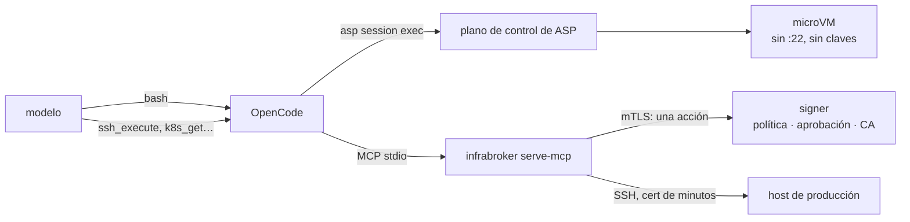

# Usar ASP con infrabroker

Decisión: [ADR-0019](../adr/0019-acceso-a-infraestructura.md). La misma pareja vista desde el broker: [`docs/SANDBOX.md` de infrabroker](https://github.com/luisgf/infrabroker/blob/main/docs/SANDBOX.md).

ASP decide **dónde corre el código del agente** y a qué red llega. [infrabroker](https://github.com/luisgf/infrabroker) decide **cómo ese agente actúa sobre hosts y clusters** sin tener nunca una credencial: el modelo pide una acción, un signer aparte la comprueba contra una política por comando y acuña un certificado SSH de minutos, el broker ejecuta, y el modelo solo recibe la salida. Juntos:

- **El guest no llega a :22 por su cuenta**, y no lo necesita. En modo `enforce` la tabla de nftables solo deja 80, 443 y DNS hacia el proxy, y el proxy marca otro puerto solo si una regla del tenant lo nombra; la conexión SSH nace en el broker, fuera de la sandbox.
- **El puente del agente SSH firma para git**, nada más ([ADR-0003](../adr/0003-identity.md), enmendado). Hosts y clusters, por infrabroker.
- **El audit de cada acción lleva el dueño de la sandbox**: el token de workload de ASP (`user_sub`, `sandbox_id`) es una identidad que infrabroker entiende.

Cada proyecto funciona solo. infrabroker tiene releases y una imagen; ASP es 0.x y no ha publicado la primera ([hoja de ruta](../roadmap.md)).

## Fase 0: el harness fuera del guest (funciona hoy)

Es el montaje de [usar ASP con OpenCode](../getting-started/opencode.md) más un servidor MCP. OpenCode corre en tu portátil o en el nodo; cada llamada a bash va a la sesión por `asp session exec`; infrabroker corre **junto a OpenCode**, como MCP stdio, y es quien abre las conexiones SSH. Nada de infrabroker entra en el guest.



1. Monta la sesión, el wrapper, el plugin y las instrucciones como en [usar ASP con OpenCode](../getting-started/opencode.md) (pasos 1 a 4, con el fichero del paso 3 de esta lista en lugar de `opencode.bash-only.json`).
2. Instala infrabroker y registra tus hosts ([Quickstart de infrabroker](https://github.com/luisgf/infrabroker/blob/main/docs/QUICKSTART.md)). Para uso personal basta el modo local, un binario y un `config.json`; para un signer aparte, [OPERATIONS](https://github.com/luisgf/infrabroker/blob/main/docs/OPERATIONS.md).
3. Usa [`integrations/opencode/opencode.infrabroker.json`](../../integrations/opencode/opencode.infrabroker.json) como `opencode.json`: es el montaje «solo bash» con un bloque `mcp` que lanza `infrabroker serve-mcp`. Pon las rutas absolutas del wrapper, del binario y del `config.json`.
4. Lanza OpenCode con `ASP_SESSION_NAME` y, si lo usas, `ASP_WORKSPACE_HOST`, como en el paso 5 de la guía de OpenCode.

**Qué corre dónde:**

| | Dónde |
|---|---|
| Las llamadas a bash del modelo | En la microVM, con el egress de la sesión |
| `ssh_execute`, `ssh_session_*`, `ssh_put_file` / `ssh_get_file`, `k8s_*` | En el proceso de infrabroker, junto a OpenCode, nunca en el guest |
| La conexión SSH y el certificado | Del broker al host; el modelo y el guest no los ven |
| Las claves del operador | Ninguna en el guest. La CA, en el signer |

### Comprobarlo

Pide al agente tres cosas:

1. `hostname && id`: tiene que responder el guest, con tu uid.
2. Que ejecute `uptime` en un host con `ssh_execute`: la respuesta termina en `[exit=0 serial=N]`, y el log del signer tiene una línea `issued` con ese `serial`. El modelo no ha visto ninguna clave.
3. Que haga `ssh <ese host>` o `nc -z <ese host> 22` desde bash: tiene que fallar. En `enforce`, la tabla de nftables descarta todo lo que no sea 80, 443 y DNS, y el proxy solo marcaría :22 si una regla del tenant nombrara ese puerto. Si no falla, el nodo no está en `enforce` (`asp node list` lo dice) o la allowlist tiene una regla con `port: 22`.

### Con `--local-net`

Con el túnel arriba la allowlist no aplica y la sesión llega a toda la LAN. El puente del agente SSH firma con las claves del operador, así que un guest hostil entraría en cualquier host de la LAN que confíe en ellas. Enciende la confirmación por firma (`--ssh-agent-confirm`) o deja esa sandbox sin claves: con `ASP_SSH_AGENT_SOCK_TEMPLATE`, una sandbox cuya ruta de socket no exista recibe un agente vacío (cero claves). Sin plantilla el puente es global al nodo y solo se apaga para todas las sandboxes a la vez (node-agent sin `SSH_AUTH_SOCK` ni `--ssh-agent-bridge`) ([red local bajo demanda](../ops-local-net.md)). La infraestructura sigue yendo por infrabroker, que en esta fase corre fuera del guest y no depende del túnel.

## Fase 1: el runtime del agente dentro de la sandbox

Cuando el agente **vive en el guest** (el caso de [ADR-0018](../adr/0018-browser-desktop.md), o cualquier runtime que no quieras en el host), sus llamadas a infrabroker salen de la sandbox. El guest le habla a `infrabroker serve-mcp-http` por HTTPS, con el token de workload de ASP como bearer. Esto es lo que cambia; nada de ello es código de ASP.

**Dónde vive el broker.** En el host de infrabroker, el mismo que recomienda para su signer, **nunca en el nodo**: el proxy de ASP se niega a marcar loopback, las direcciones del nodo y la red de los guests, y no se abre una excepción ([ADR-0019 § 2](../adr/0019-acceso-a-infraestructura.md#2-el-broker-vive-en-el-host-de-infrabroker-no-en-el-nodo)). Si ese host tiene una dirección privada (RFC 1918), el operador del nodo tiene que abrir su rango con `--egress-allow-cidr`; un tenant no puede ([red y egress](../concepts/networking-and-egress.md)).

**La allowlist del tenant.** El nombre del broker, con su puerto si no es 443:

```bash
# con una clave de API del tenant (o un token del IdP con rol admin, en el mismo Bearer)
curl -sS -X PUT "$ASP_CONTROL_PLANE_URL/v1/tenants/$TENANT/egress" \
  -H "Authorization: Bearer $ASP_API_KEY" -H 'Content-Type: application/json' \
  -d '{"rules":[{"host_pattern":"infrabroker.example.internal","port":443}]}'
```

(`PUT /v1/tenants/{id}/egress` sustituye **todas** las reglas: incluye las que ya tenías. La forma exacta está en [la API](../reference/api.md#puttenantegress).)

**El token.** Desde el guest, una petición al socket de identidad por vsock (CID 2, puerto 26502) con el `aud` que infrabroker espera:

```text
POST /v1/tokens/oidc   {"aud": "infrabroker"}
→ { "access_token": "<JWT>", "token_type": "Bearer", "expires_in": 300, "claims": { ... } }
   claims: sub=sandbox/<id>  user_sub=<dueño>  sandbox_id=<id>  tenant_id=<tenant>
```

La imagen del guest no trae un cliente HTTP por vsock ni un cliente MCP: el runtime que los use los trae él ([notas de vsock del guest](../../scripts/guest-vsock-notes.md)). El token vive cinco minutos por defecto: pide uno por llamada, o al menos uno por TTL.

**infrabroker.** El frontend HTTP con el plano de control de ASP como issuer: `oauth.issuer` = tu `ASP_OIDC_ISSUER`, `audience: "infrabroker"`, `user_claim: "user_sub"` (así cada acción se atribuye al humano dueño de la sandbox), sin `groups_claim`, y `context_claim: "sandbox_id"` (en infrabroker desde [#426](https://github.com/luisgf/infrabroker/pull/426)), para que el signer selle la sandbox en el `KeyID` del certificado y en su audit. El mismo bloque como `end_user_oidc` en `signer.json`, y `require_verified_end_user: true` en la entrada `callers` del CN del broker, para que la identidad y el contexto se verifiquen dentro de su frontera y no los afirme el broker. La receta completa está en [OPERATIONS de infrabroker](https://github.com/luisgf/infrabroker/blob/main/docs/OPERATIONS.md), junto a la de Keycloak.

**Lo que hay que saber antes de montarlo:**

- **La sandbox tiene que tener dueño.** `user_sub` solo va en el token cuando la sandbox se creó con un token del IdP (`owner_sub`); una creada con una clave de API no tiene dueño, su token no lleva `user_sub` y el frontend de infrabroker lo rechaza (`user_claim` ausente). Para la Fase 1, crea las sandboxes con el IdP ([conectar un IdP](idp.md)).
- **La autorización es por broker, no por sandbox.** Cualquier guest de tu plano de control puede pedir `aud=infrabroker`, y sin un claim de grupos el RBAC por usuario del signer está apagado: todo dueño de sandbox alcanza lo que alcance ese broker. El token da atribución, no alcance. Un claim de grupos en el token de workload es la Fase 2 de [ADR-0019](../adr/0019-acceso-a-infraestructura.md).
- **Una aprobación humana que tarde más que la vida del token falla cerrada.** Con `require_verified_end_user`, infrabroker revalida el bearer al conceder; si han pasado más de cinco minutos, la acción se deniega y hay que pedirla otra vez con un token nuevo.
- **Con `--local-net`** la sesión sale por el portátil: el nombre del broker tiene que resolverse y alcanzarse desde esa red.

**Correlar los dos audits.** La entrada de infrabroker lleva `end_user=<user_sub>`, `end_user_context=<sandbox_id>` y `serial`; `sandbox_events` de ASP lleva `sandbox_id` y `actor_sub` (quien hizo esa acción, que puede no ser el dueño), y la sandbox lleva `owner_sub`, que es el `user_sub` del token. La clave común es `owner_sub` + `sandbox_id`.
